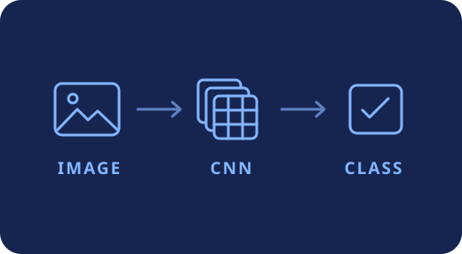
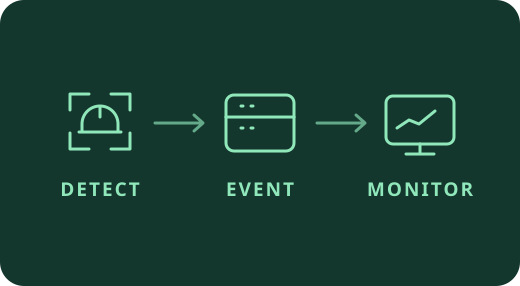

# 고규현

C# / .NET 기반 **Windows 응용 프로그램 개발**을 중심으로  
**AI 비전 · TCP/IP 통신 · 백엔드 · 데이터 처리**를 공부하고 있습니다.

---

##  기술 스택

<table>
  <thead>
    <tr><th align="left">구분</th><th align="left">기술</th></tr>
  </thead>
  <tbody>
    <tr>
      <td width="125">언어</td>
      <td>      </td>
    </tr>
    <tr>
      <td width="125">AI·ML</td>
      <td>     </td>
    </tr>
    <tr>
      <td width="125">데이터</td>
      <td>  </td>
    </tr>
    <tr>
      <td width="125">백엔드</td>
      <td>  </td>
    </tr>
    <tr>
      <td width="125">프론트·앱</td>
      <td> </td>
    </tr>
    <tr>
      <td width="125">수집</td>
      <td>  </td>
    </tr>
    <tr>
      <td width="125">DB</td>
      <td> </td>
    </tr>
    <tr>
      <td width="125">환경·버전관리</td>
      <td>  </td>
    </tr>
    <tr>
      <td width="125">IDE·도구</td>
      <td>    </td>
    </tr>
  </tbody>
</table>

---

##  프로젝트

<table>
  <tr>
    <td width="33%" valign="top">
      
       Windows · 컴퓨터 비전
       <strong><a href="https://github.com/rbgus4560/access-control-system">얼굴 인식 출입 통제 시스템 ↗</a></strong>
      
얼굴 식별과 출입 권한 판정을 연결하고, WPF에서 실시간 영상과 출입 기록을 확인합니다.

      <code>C#</code> <code>WPF</code> <code>Python</code> <code>OpenCV</code>
    </td>
    <td width="33%" valign="top">
      
       웹 · 데이터 수집
       <strong><a href="https://github.com/rbgus4560/pc-parts-crawler-service">PC 부품 크롤링·가격 비교 ↗</a></strong>
      
컴퓨존과 다나와의 상품을 수집·정제해 부품 검색과 가격 이력 조회를 제공합니다.

      <code>Python</code> <code>Selenium</code> <code>Flask</code> <code>PostgreSQL</code>
    </td>
    <td width="33%" valign="top">
      
       웹 · OCR
       <strong><a href="https://github.com/rbgus4560/hospital-record-management-service">병원 영수증 OCR·일정 관리 ↗</a></strong>
      
영수증 OCR 결과를 검토·수정하고 환자별 기록과 일정을 저장합니다.

      <code>React</code> <code>FastAPI</code> <code>CLOVA OCR</code> <code>PostgreSQL</code>
    </td>
  </tr>
  <tr>
    <td width="33%" valign="top">
      
       딥러닝 실험 · 비공개
       <strong><a href="https://github.com/rbgus4560/cnn-learning-experiments">CNN 이미지 분류·학습 비교 ↗</a></strong>
      
프레임워크, 옵티마이저와 모델 구조를 바꿔 이미지 분류 결과를 비교했습니다.

      <code>Python</code> <code>Keras</code> <code>PyTorch</code> <code>scikit-learn</code>
    </td>
    <td width="33%" valign="top">
      
       산업 안전 · 팀 프로젝트
       <strong><a href="https://github.com/rbgus4560/project01_Safety-AI-Monitoring-Service">AI 안전 관제 시스템 ↗</a></strong>
      
영상의 객체 탐지 결과를 서버에서 위험 이벤트로 판정하고 관제 화면에 표시합니다.

      <code>Flutter</code> <code>Python</code> <code>FastAPI</code> <code>YOLO</code>
    </td>
    <td width="33%"></td>
  </tr>
</table>

---

##  학습 및 실습

| 분야 | 저장소 / 내용 | 주요 내용 |
|---|---|---|
| C# / .NET | C# 및 Windows 응용 프로그램 실습 | C# 기본 문법 · 객체지향 · .NET · WinForms · WPF |
| Python | [Learning / Python](https://github.com/rbgus4560/Learning/tree/main/1.%20python) | 기초 문법 · 함수 · 객체지향 · 예외처리 |
| 자료구조 | [Learning / 자료구조](https://github.com/rbgus4560/Learning/tree/main/2.%20%EC%9E%90%EB%A3%8C%EA%B5%AC%EC%A1%B0) | 선형 자료구조 · 정렬 · 트리 · 그래프 |
| SQL | [Learning / SQL](https://github.com/rbgus4560/Learning/tree/main/3.%20SQL) | 데이터 모델링 · SQL 기본/활용 · 최적화 |
| Java / Spring | Java 및 Spring 기반 웹 애플리케이션 실습 | Java · Spring MVC · JSP · DB 연동 |
| Computer Vision | OpenCV 및 딥러닝 비전 실습 | OpenCV · YOLO · PyTorch |

---

##  현재 집중하고 있는 분야

- C# / .NET 기반 Windows 응용 프로그램 개발
- WinForms / WPF를 활용한 GUI 프로그램 구현
- TCP/IP 기반 Client / Server 통신
- YOLO · OpenCV · ONNX를 활용한 AI 비전 기능 연동
- Java / Spring Boot 기반 백엔드 및 REST API 개발
- React 기반 Web Frontend 구현
- 크롤링 데이터 정제 · DB 저장 · 서비스 연동

---
